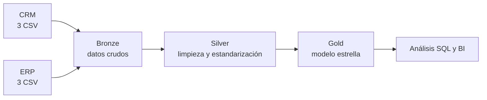

# Data Warehouse con arquitectura medallón en PostgreSQL

Data warehouse de ventas construido con **SQL (PostgreSQL)**, que integra datos de dos sistemas fuente (CRM y ERP) en tres capas (**bronze, silver y gold**) y los deja listos para análisis en un **modelo estrella**.

> Proyecto académico de la Universidad Libre. La base del ejercicio se desarrolló en clase sobre SQL Server; yo la repliqué y adapté a PostgreSQL (Neon + DBeaver).

## Arquitectura



| Capa | Qué contiene | Qué se hace |
|---|---|---|
| **Bronze** | Los 6 archivos fuente, tal como llegan | Carga sin transformar, para poder rastrear cualquier dato hasta su origen |
| **Silver** | Tablas limpias y estandarizadas | Deduplicación, normalización de valores, corrección de fechas e importes |
| **Gold** | 2 dimensiones y 1 tabla de hechos | Modelo estrella listo para consultas analíticas y reportes |

## Datos de origen

| Sistema | Tabla | Registros |
|---|---|---|
| CRM | `cust_info` (clientes) | 18.494 |
| CRM | `prd_info` (productos) | 397 |
| CRM | `sales_details` (ventas) | 60.398 |
| ERP | `cust_az12`, `loc_a101`, `px_cat_g1v2` | Datos complementarios de clientes, ubicación y categorías |

Las 3 tablas CRM suman **79.289 registros**.

## Calidad de datos

Al perfilar los datos crudos encontré estos problemas, que la capa silver corrige antes de que lleguen a gold:

| Tabla | Problema detectado | Registros |
|---|---|---|
| `cust_info` | IDs de cliente duplicados | 6 filas sobrantes |
| `cust_info` | IDs de cliente nulos | 4 |
| `cust_info` | Género vacío | 4.578 (25 % de la tabla) |
| `prd_info` | Fecha de fin anterior a la de inicio | 200 |
| `sales_details` | Fechas de orden inválidas | 19 |
| `sales_details` | Importe distinto de cantidad × precio | 35 |

La capa silver se carga con el procedimiento almacenado `silver.load_silver()` (PL/pgSQL), que vacía y recarga las tablas en una sola llamada y maneja los errores.

## Modelo de datos (gold)

Modelo estrella con una tabla de hechos y dos dimensiones:

- `fact_sales`: una fila por línea de venta (**60.398** registros), con fechas, cantidad, precio e importe.
- `dim_customers`: clientes únicos (**18.484**), con datos demográficos y ubicación.
- `dim_products`: productos con su categoría y subcategoría.

## Estructura del repositorio

```
sql-data-warehouse-project/
├── datasets/    # CSV de origen (CRM y ERP)
├── docs/        # documentación y diagramas del modelo
├── scripts/     # scripts SQL por capa (bronze, silver, gold)
├── tests/       # consultas de validación de calidad
└── README.md
```

## Cómo ejecutarlo

1. Crea una base de datos en PostgreSQL (yo usé [Neon](https://neon.tech)) y conéctate con DBeaver o `psql`.
2. Ejecuta el script que crea los esquemas `bronze`, `silver` y `gold`.
3. Carga los CSV de `datasets/` en las tablas de bronze (`\copy` o la herramienta de importación de DBeaver).
4. Ejecuta `CALL silver.load_silver();` para poblar la capa silver.
5. Ejecuta el script de gold para crear el modelo estrella.
6. Corre las consultas de `tests/` para validar los resultados.

## Adaptación de SQL Server a PostgreSQL

| SQL Server | PostgreSQL |
|---|---|
| `BULK INSERT` | `\copy` / `COPY` |
| T-SQL en procedimientos almacenados | PL/pgSQL (`CREATE PROCEDURE` + `CALL`) |
| `USE` / `GO` | Se eliminan; se trabaja con esquemas |

## Análisis sobre este modelo

Sobre la capa gold hice un análisis exploratorio (EDA) en SQL. Algunos hallazgos:

- La categoría **Bikes** concentra el **96,5 %** de los ingresos.
- El **10 %** de clientes con mayor gasto aporta el **40,3 %** de los ingresos.
- Las ventas crecieron **179,8 %** entre 2012 y 2013.

## Herramientas

PostgreSQL · PL/pgSQL · Neon · DBeaver · Git y GitHub

## Autor

**Juan Pablo Cifuentes Téllez**, estudiante de Ingeniería de Sistemas en la Universidad Libre (Bogotá), con enfoque en Business Intelligence y análisis de datos.

[LinkedIn](https://www.linkedin.com/in/juan-pablo-cifuentes-7524ba174) · [GitHub](https://github.com/juancifuentes07)
